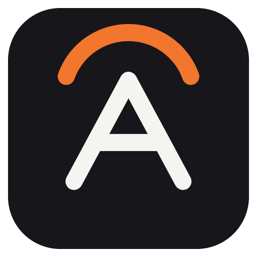
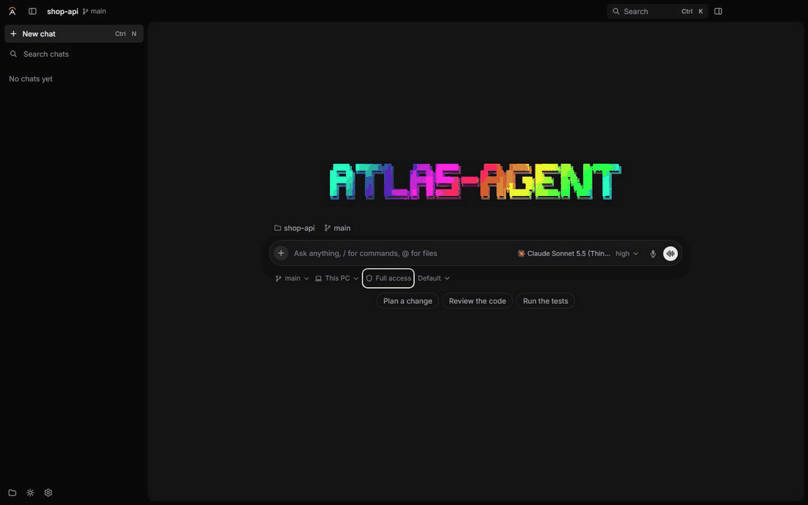
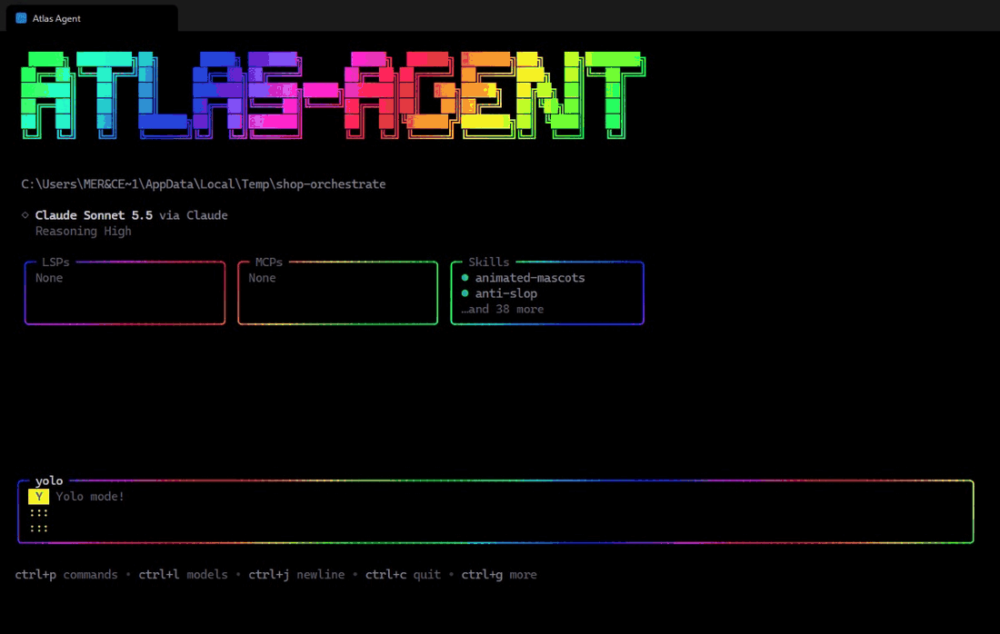
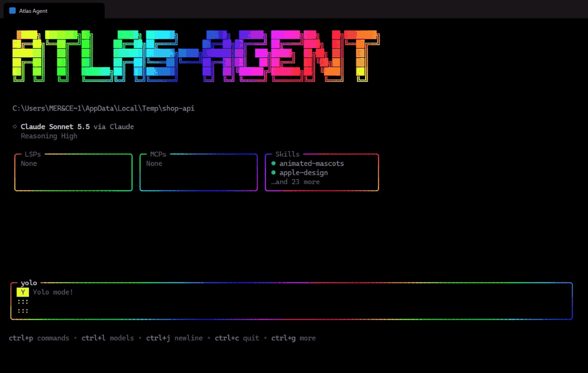
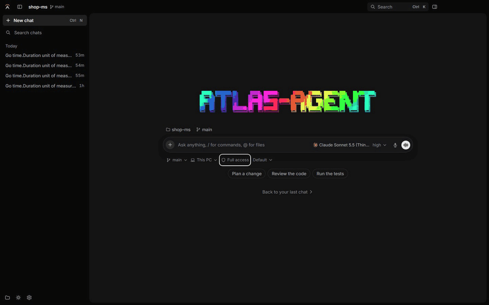
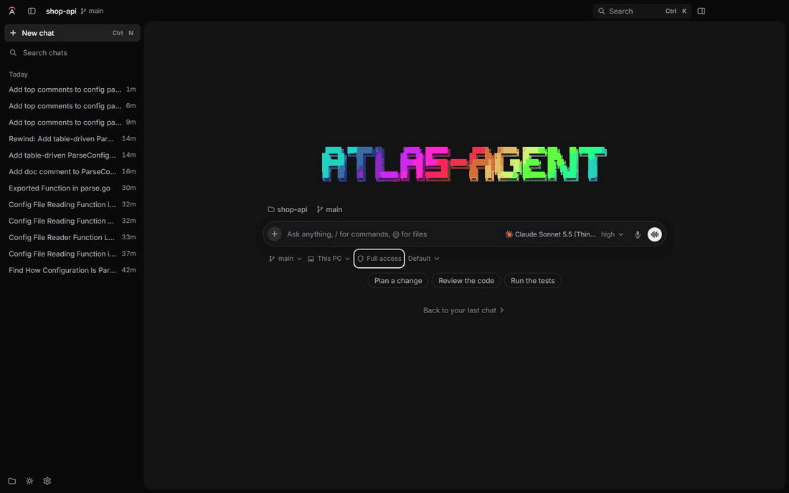
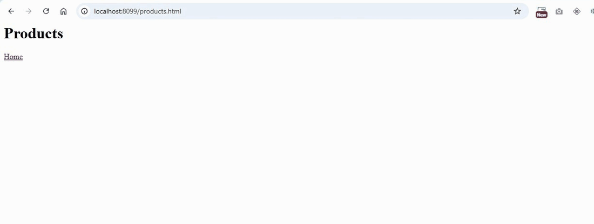
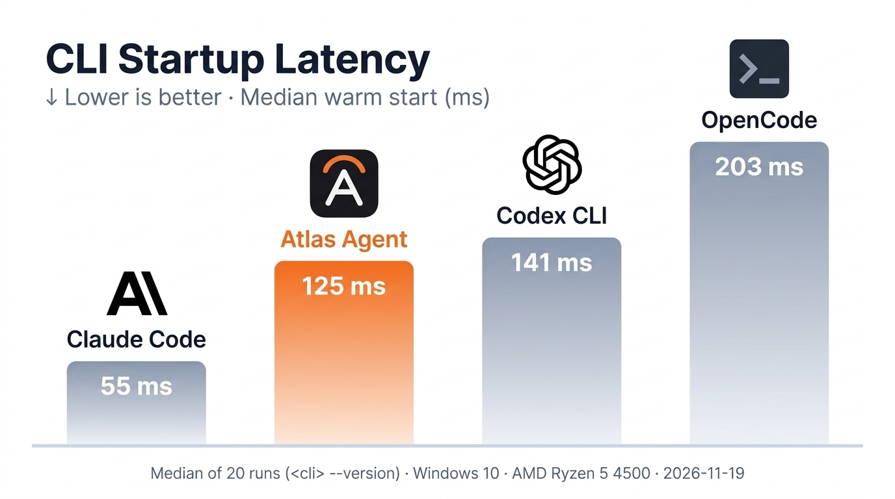
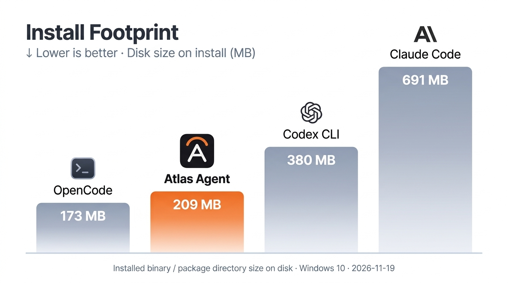

<p align="center">
  
</p>

<h1 align="center">Atlas Agent</h1>

<p align="center">
  <strong>One coding agent for the AI subscriptions you already pay for: ChatGPT, Claude, Copilot and more.</strong><br>
  Or any API key or local model. Terminal, desktop and web. A team of agents, not a chat window.
</p>

<p align="center">
  <a href="https://www.npmjs.com/package/@atlas-coder/atlas-agent"></a>
  <a href="https://github.com/Omerfaruk-aydn/Atlas-Agent/releases/latest"></a>
  <a href="https://github.com/Omerfaruk-aydn/Atlas-Agent/actions/workflows/lint.yml"></a>
  <a href="LICENSE.md"></a>
  <a href="https://go.dev"></a>
  <a href="https://github.com/Omerfaruk-aydn/Atlas-Agent/stargazers"></a>
</p>

<p align="center">
  
</p>

<p align="center">
  <strong>71</strong> providers · <strong>10</strong> coding-plan sign-ins · <strong>80+</strong> built-in tools · <strong>10</strong> specialist subagents · <strong>125 ms</strong> start · one static Go binary
</p>

## Install

```sh
npm install -g @atlas-coder/atlas-agent
```

<details>
<summary>Other ways: install script, manual download, from source</summary>

**macOS · Linux**

```sh
curl -fsSL https://github.com/Omerfaruk-aydn/Atlas-Agent/releases/latest/download/install.sh | bash
```

**Windows (PowerShell)**

```powershell
irm https://github.com/Omerfaruk-aydn/Atlas-Agent/releases/latest/download/install.ps1 | iex
```

Binaries for every platform, source builds and upgrades: [Install guide](docs/guide/install.md).

</details>

Then, in your project:

```sh
atlas-agent login        # sign in with a plan you already pay for, or set an API key
atlas-agent              # terminal UI
atlas-agent app          # desktop app (Windows x64)
atlas-agent web          # web UI
```

Describe a task with a definition of done, for example *"the test in `internal/shell` fails on Windows,
find out why and fix it"*. Everything with a side effect asks first.

## Why Atlas Agent

**Any model, any plan.** The model is a setting, not a product decision. Use an API key, a local model, or
sign in with a subscription you already have: ChatGPT, Claude, GitHub Copilot, Google Antigravity, Kimi,
Z.ai, MiniMax. Switch mid-conversation, or give each job its own model: a strong one for the work, a cheap
one for summaries, another to judge whether a goal is done.

**A team, not a chat window.** Subagents read and search in their own context and hand back only the
answer, so a twenty-file investigation costs your session a paragraph. An orchestrator splits large work
across parallel workers; `debate` makes models argue before they agree; `/goal` keeps working until a
separate judge confirms it is finished.

**Safe to leave running.** Every change ends in a review card you can undo file by file, any message can be
rewound with the files going back too, side effects ask first, and a shell-script hook can veto any tool call.

**Light.** A single static binary: 125 ms to start, 209 MB installed, no runtime to install.

## See it work

Every clip is a real session on a real model, sped up where noted.

<table>
  <tr>
    <td width="50%" valign="top">
      <br>
      <strong>Orchestrator.</strong> Plans, runs workers in parallel and has a verifier check the result.
    </td>
    <td width="50%" valign="top">
      <br>
      <strong>Subagents.</strong> The reading stays in their context; only the answer comes back.
    </td>
  </tr>
  <tr>
    <td width="50%" valign="top">
      <br>
      <strong>Goals.</strong> <code>/goal</code> keeps going until a judge model confirms it is done.
    </td>
    <td width="50%" valign="top">
      <br>
      <strong>Switch models.</strong> One thread, Claude to Gemini, full context kept.
    </td>
  </tr>
  <tr>
    <td width="50%" valign="top">
      <br>
      <strong>Review before you keep.</strong> Undo per file; your own later edits are never overwritten.
    </td>
    <td width="50%" valign="top">
      <br>
      <strong>Real browser.</strong> Drives its own Chrome, finds the 404 and fixes it.
    </td>
  </tr>
</table>

<p align="center"><a href="docs/guide/features.md"><strong>All eighteen features →</strong></a> debate, configure by chat, rewind, hooks, LSP refactors, skills, MCP, worktrees, PR review, headless JSON, Windows desktop control, voice.</p>

## Benchmarks

Measured on one machine (Windows 10, Ryzen 5 4500), each harness scored by the same hidden checks.

<table>
  <tr>
    <td width="50%"></td>
    <td width="50%"></td>
  </tr>
</table>

**Same model, different harness**, two tasks, every attempt from a fresh repository:

| Model | Harness | Passed | Mean time |
| --- | --- | ---: | ---: |
| Claude Sonnet 5.5 | Claude Code | 6 / 6 | 24 s |
| Claude Sonnet 5.5 | **Atlas Agent** | **6 / 6** | **34 s** |
| GPT-5.6 Luna | Codex CLI | 4 / 4 | 48 s |
| GPT-5.6 Luna | **Atlas Agent** | **4 / 4** | **95 s** |

Equal on outcome, slower on time: Atlas has an independent reviewer check each change before it reports done,
and on GPT-5.6 Luna Codex ran at low reasoning effort while Atlas used the default, medium. Two tasks is a
smoke test, not a ranking. Method, more charts and how to reproduce: [Benchmarks](docs/guide/benchmarks.md).

## Providers

| | |
| --- | --- |
| **Frontier APIs** | Anthropic, OpenAI, Google, xAI, DeepSeek, Mistral and more |
| **Coding plans** | ChatGPT (Codex), Claude, GitHub Copilot, Google Antigravity, Kimi, Z.ai, MiniMax, Alibaba |
| **Run it yourself** | Ollama, LM Studio, any OpenAI-compatible server |

Setup for each, model roles and fallbacks: [Providers and models](docs/guide/providers.md).

## How it compares

| | **Atlas Agent** | Claude Code | Codex CLI | OpenCode |
| --- | --- | --- | --- | --- |
| License | MIT | Proprietary | Apache-2.0 | MIT |
| Models | Any provider, per role | Anthropic | OpenAI | Any provider |
| Use your subscription | ChatGPT, Claude, Copilot, Antigravity and more | Claude | ChatGPT | Some |
| Parallel workers | `orchestrate`, `delegate` | Subagents | Subagents | Subagents |
| Multi-round model debate | `debate` | — | — | — |
| Install size | 209 MB | 691 MB | 380 MB | 173 MB |

Other tools move fast; check before deciding. The honest weaknesses are listed too: [Overview](docs/guide/overview.md).

## Documentation

| Get going | Use it | Make it yours |
| --- | --- | --- |
| [Overview](docs/guide/overview.md) | [CLI reference](docs/guide/cli.md) | [Skills, MCP and hooks](docs/guide/extending.md) |
| [Install and first session](docs/guide/install.md) | [Agents, delegation and goals](docs/guide/delegation.md) | [Configuration](docs/guide/configuration.md) |
| [Feature tour](docs/guide/features.md) | [Tools](docs/guide/tools.md) | [Recipes and prompting](docs/guide/recipes.md) |
| [Benchmarks](docs/guide/benchmarks.md) | [Providers and models](docs/guide/providers.md) | [Architecture and development](docs/guide/architecture.md) |
| | [Context and cost](docs/guide/cost.md) | [Troubleshooting and FAQ](docs/guide/troubleshooting.md) |
| | [Permissions and safety](docs/guide/safety.md) | |
| | [Sessions and worktrees](docs/guide/sessions.md) | |

## Contributing

Issues and pull requests are welcome: bug reports, provider fixes, new tools, documentation. Keep a change to
one concern, add a test that fails without it, and run `go build ./...` and `go test ./internal/...`. See
[CONTRIBUTING.md](CONTRIBUTING.md), the [good first issues](https://github.com/Omerfaruk-aydn/Atlas-Agent/labels/good%20first%20issue)
and [where help is most useful](docs/guide/troubleshooting.md#known-gaps). Contributions are covered by the
[CLA](CLA.md).

## License

MIT, see [LICENSE.md](LICENSE.md).

<p align="center">
  <strong>If Atlas Agent is useful to you, a ⭐ helps other people find it.</strong><br>
  <a href="https://github.com/Omerfaruk-aydn/Atlas-Agent/releases">Releases</a> ·
  <a href="https://github.com/Omerfaruk-aydn/Atlas-Agent/issues">Issues</a> ·
  <a href="https://www.npmjs.com/package/@atlas-coder/atlas-agent">npm</a>
</p>
