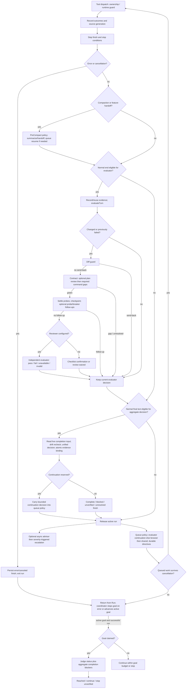

# Agentic roadmap: Phase 0 audit

Audit date: 2026-10-27 (Europe/Istanbul). Scope: Phase 0 of
`agentic-roadmap-master-prompt.md`, against the **working tree**, including the
user's uncommitted implementation. HEAD:
`e5c2064aa04e9fec099def6238986d6ef3401374`.

This is an implementation inventory, not certification that future acceptance
criteria pass. No production code, configuration, schema or existing tests were
changed. Later phases require user approval. No live model evaluation was run.

## Baseline and preservation

The starting status contains 82 paths: 49 tracked status entries (including two
deleted documents) and 33 untracked files. `git diff --stat` reports 48 files, 1,264
insertions and 336 deletions; untracked contents are not part of that statistic.
The supplied master prompt itself was already untracked. The evidence directory
contains the original status, diff statistic and SHA-256 inventory, including
explicit `MISSING` markers for the two existing deletions. These are the
authoritative per-file ownership records; an existing implementation below must
not be treated as a Phase 0 change.

See [baseline results](agentic-roadmap-baseline.md),
[prompt measurements](agentic-roadmap-prompt-sizes.json) and
[standalone completion diagram](agentic-roadmap-completion-flow.mmd).

## Verified differences from the brief

1. `completion_decision.go` and `completion_input.go` already exist as untracked
   user work. `decideTurnCompletion` is called from `Run`, persists a
   revision/fingerprint-bound decision, and can withhold completion or reserve a
   continuation. It is more than a shadow-only comparison. The comment on
   `harnessmetrics.CompletionDiverged` still says "shadow mode".
2. The current unified vocabulary is `complete | incomplete | blocked |
   unverified`, not the proposed `pass | continue | unresolved | unverified`.
   `evaluatorDecision` separately carries continuation/unresolved/unverified text.
   Future consolidation needs an explicit compatibility decision, not a rename
   assumed from the brief.
3. Evaluator errors and malformed verdicts currently return `reviewUnavailable`
   or `reviewInvalidReport` plus `Unverified`. The leading evaluator comment
   still describes fail-open. `checkContract` now sends an unreadable plan back;
   its leading comment also overstates fail-open. Plan review still continues
   on reviewer error or an unparseable verdict. Initialization failures can
   disable the reviewer. These are different failure policies.
4. `strategy_monitor.go` already normalizes error classes, detects rephrased
   retries and repeated non-polling observations, requests a strategy change,
   and eventually stops. Item 2.7 is an extension, not a fresh detector.
5. `context_fit.go` already elides old tool outputs on a copied request and
   caps output to fit the active model. The untracked source-drift code and
   modified runtime guard already cover opaque source changes. These must be
   incorporated into items 2.1 and 3.3.
6. `agent_modes.go:runArchitectEditor` and `tools/mutation.go` already provide
   architect/editor and mutation-engine building blocks. Neither fully meets
   the corresponding roadmap gate acceptance criteria.
7. `atlas context inspect --summary` already exposes current request metadata
   and schema sizes; it is not a historical per-turn trace. Its estimate uses
   UTF-8 **runes** / 4, whereas `usage_fallback.go:approxTokenCount` uses UTF-8
   **bytes** / 4. Phase 1 should label both rather than silently conflate them.
8. Existing `Harness.ParallelAlternatives` and work-plan plan-review/probe/
   breaker defaults are enabled. The brief requires **new** parallel/model-call
   behavior to default off. Extending these controls needs a documented
   compatibility choice; Phase 0 does not alter their defaults.
9. Section 3 points phase reports to section 11; the actual format is section
   13. This audit follows section 13 and the user's explicit instruction.

## Per-item code map

Paths below are relative to the repository root. "Gap" means the specific
roadmap acceptance criterion is not provided by the inspected path; it does not
mean the repository has no related capability. Proposed integration points are
design candidates, not implemented changes. Risk is the main implementation
hazard, not a finding that the current code necessarily has a defect.

### Phase 1: measurement

| Item | Existing code and behavior | Gap | Integration point | Risk |
|---|---|---|---|---|
| 1.1 Turn trace and `eval trace` | `internal/harnessmetrics/harnessmetrics.go` appends bounded rotating JSONL events, logs a write failure once and leaves the turn running. `internal/agent/context_inspector.go`, `internal/engineering/context_inspector.go` and `internal/cmd/context_profiles.go` record and expose the latest request's metadata. `agent.go` step hooks and `runtime_guard.go` already observe execution. | No `eval trace` command or complete historical turn/step/model/tool/gate timeline with correlated usage, cache, latency and verdict reasons. Latest-context metadata is overwritten, not an event history. | Extend the existing harness recorder with a versioned trace envelope and turn/step/call IDs; add CLI reading through `internal/cmd/eval.go`. Reuse `secret_redaction.go` and vault redaction before persistence. | Raw arguments, outputs or prompts can leak secrets; rotation can break joins. Best-effort trace must not turn existing accounting errors into silent success. |
| 1.2 Bench expansion and ablation | `internal/evaluation/bench.go`, `internal/cmd/eval_bench.go`, `bench/tasks/*/task.json` implement hidden-test tasks, reference validation, variants and cost/token/time reporting. There are nine task directories. `internal/evaluation/attempts.go` already computes pass@1/pass@k for attempt reports. | No 40–60-task multilingual suite or complete named gate-ablation matrix with fail-open totals and previous-run regression comparison. Attempt-report metrics should be reused, not assumed to already appear in bench reports. | Extend existing manifests and bench summary/report; add deterministic reference tasks and gate config variants. | Unequal variants, provider failures and hidden-test collisions distort results; paid runs need separate approval. |
| 1.3 Gate metrics | `harnessmetrics.go` has contract, evaluator, plan-review, alternatives, compaction, loop and completion-divergence event kinds; `internal/cmd/stats_harness.go` consumes summaries. | No uniform trigger/pass/send-back/fail-open/token/duration schema for every gate, particularly unavailable/invalid reviews and background advisor/escalation. | A small gate-observation API in `internal/harnessmetrics`, consumed by existing gate helpers and stats. | Double charging shared reviewer calls; treating no verdict as pass; missing asynchronous events. |
| 1.4 Compaction quality eval | `agent.go:Summarize`, `internal/agent/templates/summary.md`, `feature_handoff.go` and prompt comparison/evaluation packages exist. | No synthetic long-session retention evaluator covering files, decisions, constraints, open work and verification evidence across summary and handoff. | Add fixtures and retention scoring under `internal/evaluation`, exposed through `eval`; mock summary results for deterministic tests. | Self-scoring and wording-based matches can overstate retention; live summarization is a separately approved experiment. |
| 1.5 Prompt token golden | `prompts.go`, `prompt/prompt.go`, `prompt/protocols.go`, `tool_deferral.go` assemble templates and conditional protocols. `prompt_quality_test.go` verifies render profiles and contract presence. | No token-size golden with a >5% growth threshold. Phase 0 supplies 16 measured fixtures, not a new test gate. | Reuse the fixture matrix in a deterministic test, pin encoding/version and normalize variable inputs explicitly. | Platform line endings, metadata and tokenizer changes create false regressions; fixture sizes are not billed runtime usage. |

### Phase 2: verification

| Item | Existing code and behavior | Gap | Integration point | Risk |
|---|---|---|---|---|
| 2.1 One completion pipeline | `agent.go:evaluateTurn` call site, `evaluator.go`, `contract_gate.go`, `diff_guard.go` perform ordered checks; user work in `completion_decision.go`, `completion_input.go`, `source_drift.go` and `engineering/completion.go` binds aggregate evidence and detects drift. | Still separate pre-dispatch/runtime, evaluator/contract, aggregate and goal paths. No single explicit staged build/test/lint/changed-file secret scan/test-quality/review pipeline. Existing aggregate decision is a substantial foundation. | Extract stage adapters into separate files around `evaluateTurn` and `decideTurnCompletion`; retain evidence fingerprints and legacy outputs until compatibility is tested. | Certifying stale evidence, contradicting continuations, skipping bash/codegen edits or overwriting uncommitted completion work. |
| 2.2 Structured evaluator verdict | `evaluator.go:parseEvaluatorVerdict` scans `VERDICT:` text and requirement lines. Failed/invalid review status is now explicit. Structured findings also exist in engineering workflow records. | No enforced JSON/tool schema with severity/file/line/summary/evidence and one repair attempt. The brief's eventual fail-open policy differs from current unverified behavior. | Define a typed reviewer report at `runEvaluator`/parser boundary; adapt to existing finding storage and `reviewStatus`. | A malformed response must never become a pass; policy change can weaken current completion guarantees. |
| 2.3 Red-to-green workflow | Contract command ledger tracks exit code, directory and edit sequence; `contract_gate.go` creates old-code probes and green checkpoints. `errmemory` learns when a failed command later passes. Runtime verification journal binds checks to source generation. | Red evidence is not uniformly a first-class requirement-specific obligation captured before editing and paired with post-edit green plus regression checks. Retrospective old-code probes are related but different. | Extend work/requirement evidence in `internal/engineering` and `internal/workplan`; use impact-analysis selected checks and short coder workflow guidance. | Counting a scratch check as project proof, skipping the pre-edit failure, or marking a changed check as the same check. |
| 2.4 Lint-fix loop | `tools/edit.go`, `write.go`, `multiedit.go` notify LSP; multiedit waits for diagnostics. `tools/lint_run.go` wraps `internal/lint` and returns structured metadata. | No common before/after diagnostic delta gate after every edit, new-error obligations, retry count or deterministic handoff to stagnation handling. | Shared post-edit helper and a completion stage; baseline diagnostics per source fingerprint. | Existing diagnostics may be mistaken for regressions; slow LSPs can block every edit or race stale results. |
| 2.5 Mutation quality | `tools/mutation.go:NewMutationTestTool`, `internal/experiments` and `mutation_run_test.go` already run a green baseline plus external engine, parse a fresh report and compare source fingerprints, including deferred integrity checks. | No bounded built-in Go mutator or automatic changed-line gate with per-language adapters. Integrity detection is not guaranteed restoration; current source changes are reported for inspection/recovery. | Extend the experiments/tool implementation, isolate mutants in disposable copies/worktrees and adapt output into the completion pipeline. | A canceled external engine can leave mutations; preserve all unrelated dirty work and bound runtime. Opt-in for the new gate. |
| 2.6 Property/fuzz suggestion | Testing tools, impact analysis and general engineering workflow guidance exist (`tools/impact_analysis.go`, `templates/coder.md.tpl`). | No generic changed-code signal classifier that emits a single justified property/fuzz suggestion. | A cheap deterministic analyzer alongside test-quality stage, advisory only. | Noisy suggestions or domain-specific heuristics can add ceremony to small fixes. |
| 2.7 Stagnation | `loop_detection.go` hashes call/result pairs. `strategy_monitor.go` normalizes error classes, detects rephrased failures, exempts expected polling, records strategy signals and stops after repeated reviews. Aggregate continuation also has progress-signature/no-progress budgets. | No unified objective progress vector based on green tests, files/findings and closed requirements, nor oracle escalation. | Extend these monitors and durable continuation counters, reusing `contract_alternatives.go`; do not add a competing detector. | Legitimate waiting or exploration can look stalled; duplicated budgets can terminate productive work early. |
| 2.8 Evidence-linked learned rules | `errmemory/errmemory.go` stores signature/example/command/fixes/last/fixed; `harnessmetrics/strategy.go` derives checks from events. User work in `engineering/learned_methods.go` and `method_outcomes.go` records runtime evidence, source identity and independent task outcomes. | Not every rule has session/turn/signature provenance, expiry, use counters and benefit-based weakening/removal. Learned methods already enforce more provenance than error memory. | Version existing stores and attach event/evidence IDs; reuse method standing rather than inventing a parallel promotion policy. | Old records may lack evidence; untrusted/transient advice must not become permanent instructions. |

### Phase 3: context

| Item | Existing code and behavior | Gap | Integration point | Risk |
|---|---|---|---|---|
| 3.1 Cache preservation | `agent.go` appends goal, task ledger, browser contract, work-plan/checklist/strategy and delivery context to system text per request. `tool_deferral.go` adds conditional tool protocols and marks tools for cache; `budget_line.go` appends trailing step guidance. | Goal/contract changes still change system bytes; no stable-prefix acceptance test or complete cache-hit trace. | Preserve the base prompt and place mutable session blocks after a defined cache boundary or in a trailing context message. | Moving durable requirements can lose them during summary or change provider caching/ordering semantics. |
| 3.2 Context anxiety | `budget_line.go` already describes utilization, compaction point and step count; near compaction it asks for state/next-step notes. | No explicit assurance to continue quality work through handoff/compaction; no utilization-bucket premature-ending/gate-failure metrics. | Small budget-line wording change later plus trace dimensions, preserving trailing placement. | Overriding real budgets or encouraging unbounded work; avoid changing the protected authorization block. |
| 3.3 Adaptive pruning | User's `context_fit.go` copies requests, preserves non-result parts and a two-message tail, elides older outputs above 2,048 bytes to a 400-byte prefix, then caps output against the active model. `context_inspector.go` supports user result exclusion/pinning. | Not semantic or step-aware: no last-K-step protection, edited-file latest-state protection or error-line retention policy. | Extend the existing elision selector, with tool-pair invariants and retained-output metadata; keep DB history unchanged. | A prefix may remove the decisive error or recent source; a message tail is not a step tail. |
| 3.4 Idle compaction | Active-turn threshold compaction and pre-compact hooks exist in `agent.go`; `automation.go` provides cancelable background scheduling patterns. | No session idle/cache-expiry-aware compaction worker with safe user-resume cancellation. | Reuse summary service with a separate idle admission/revision check, rather than compact from TUI `Update`. | Concurrent user input, provider cache assumptions and hidden background model cost. |
| 3.5 File path references | `message/attachment.go`, `message.PromptWithTextAttachments` and `agent.go` pass attachment content; `prompt_context.go` bounds text used for intent selection to 16 KiB. | No size-threshold path/bytes/symbol-summary text mode. Intent-selection truncation does not reduce attached model payload. | Add a text-attachment representation before prompt assembly; keep binary/image/PDF paths unchanged. | Broken relative paths or stale summaries prevent rereading; content minimization must not silently omit requirements. |
| 3.6 Clean-session handoff | `feature_handoff.go` deterministically replaces current-session context at a completed feature boundary, using plan/progress/messages/files/jobs after checks pass and ~40% context occupancy. | It is a same-session summary replacement, not a linked new session with an explicit structured packet and `/handoff` UX or retention comparison. | Reuse packet collection, checklist and progress data; integrate session creation/tree and evaluation retention tests. | Losing steering/authorization/effect evidence or duplicating an in-flight operation. |

### Phase 4: model routing

| Item | Existing code and behavior | Gap | Integration point | Risk |
|---|---|---|---|---|
| 4.1 Phase model/effort | `coordinator.go` resolves role models/effort and adapts work-budget effort; `role_routing.go` resolves named-agent roles; `internal/cmd/model_roles.go` exposes roles. | No explicit exploration/planning/editing/verification/review stage resolver with sparse transition events and cache-cost measurement. | Add a phase resolver beside existing model/effort resolution, reuse `Options.ModelRoles`. | Model switching invalidates cache, loses capabilities or causes oscillation. |
| 4.2 Architect/editor | `agent_modes.go:runArchitectEditor` already enforces named distinct roles, owned paths, read-only architect, source stability, restricted editor tools and a 64 KiB plan bound. `agent_tool.go` exposes `architect_edit`. | Plan remains free text; no machine-checked edit-intent/invariant schema, semantic deviation protocol or automatic build/test failure return to architect. | Extend existing mode and shared task/evidence contracts; avoid adding a duplicate delegate workflow. | Allowed-path confinement is not semantic plan conformance; role model costs need explicit bounds. |
| 4.3 Oracle | `advisor.go` already runs bounded read-only review and escalation; `coordinator.go:buildAdvisor/buildEscalator` resolve models with fallbacks. | No agent-callable `oracle` tool combining a question, context, options and per-session budget, or strategy-monitor invocation. | Thin tool adapter over reviewer/escalator helpers with explicit use/cost limits; preserve automatic config behavior. | Recursive advice, unintended calls, insufficient authorization or a costly fallback chosen as "strongest". |
| 4.4 Cross-family reviewer | `coordinator.go:buildEvaluator` uses explicit evaluator role, otherwise advisor, otherwise the writer's large model. | No authorized-provider/family diversity resolver or explicit fallback metric. | Add selection before existing `buildEvaluator` fallback chain and share canonical model-family identity. | A different provider may be unavailable, unauthorized or not actually a different family. |

### Phase 5: workflow and permissions

| Item | Existing code and behavior | Gap | Integration point | Risk |
|---|---|---|---|---|
| 5.1 Spec mode | `internal/workplan` loads `.atlas/work.json`; `engineering` work/delivery state and workflow controls persist requirements, stages and evidence. Plan permission mode and `exit_plan_mode` already support approval of implementation. | No requirements/design/tasks Markdown triplet with stage approvals and tested two-way synchronization. There are already several related state views. | Define canonical structured work data and explicit revision-aware Markdown projections; use existing TUI dialog and workflow services. | Dual sources of truth, lost edits and ambiguous approval; do not assume `.atlas/work.json` alone owns all execution state. |
| 5.2 Steer mode | `agent.go:drainQueueForStep` folds eligible queued calls into active steps; request/checklist and accepted-prompt handling preserve task context. | No explicit TUI steer-versus-next-turn choice and proven durable incorporation of each steering requirement through compaction. | Extend queue admission metadata, accepted request ledger and TUI input controls. | Steering cancellation races, queue ordering and treating a follow-up as replacement authorization. |
| 5.3 Runtime permission elevation | `permission/permission.go` provides per-call and persistent grants, runtime mode/allowlist updates and pub/sub decisions; `tools/exit_plan_mode.go` asks to leave read-only mode. `headless.go` rejects unavailable prompts. | No general scoped directory/domain/command-category elevation tool with call/turn/session expiry or headless policy-file equivalent. | Extend permission service request/grant scope; thin tool and dialog adapters. | A temporary grant becoming permanent, or an allowlist bypassing plan/ownership restrictions. |
| 5.4 Auto-approve classifier | `tools/command_policy.go`, `tools/safe.go`, permission modes/categories and hooks already perform deterministic permission decisions. | No model gray-area `safe/risky/unknown` classifier, labeled false-safe dataset or uniform audit event. | Place deterministic denials first, optional bounded classifier only on unresolved requests; fail closed to prompt. | False-safe approvals; destructive categories must remain outside automatic model approval. |
| 5.5 Output styles | Templates contain communication rules; usage profiles exposed in `cmd/context_profiles.go` combine output behavior with other options. | No scoped `.atlas/output-styles/*.md` loader or `/style` selector independent of usage profiles and the stable prefix. | Dedicated style resolver beside prompt assembly, with late prompt placement and existing config scope. | Style text can smuggle instructions or invalidate cache; user files need size and precedence rules. |
| 5.6 Safe mode | `config/load.go`, `internal/shellconfig`, hooks, skills, MCP and context loaders have separate initialization paths. Permission plan mode is read-only execution, not customization isolation. | No `--safe-mode` startup switch that bypasses all listed customizations before they execute; no corresponding diagnostic banner. | Earliest CLI/config bootstrap, provider-only config extraction and downstream capability suppression. | Setting the flag after `atlasrc`/hook loading is too late; provider configuration may itself come from shell config. |

### Phase 6: parallel correctness

| Item | Existing code and behavior | Gap | Integration point | Risk |
|---|---|---|---|---|
| 6.1 Attempts and tournament | `contract_alternatives.go` creates two snapshot worktrees after repeated failures, asks for distinct approaches, selects from passing command evidence and asks the agent to apply the winner. `delegate_tool.go` reuses concurrency limiting. | Not a general budgeted 3–5-attempt tournament with typed summaries, build/regression elimination and pairwise cross-family judging. | Extend current alternative state and shared subagent limits; replay winner through the binding completion decision. | Dirty snapshot loss, ownership overlap, unbounded cost and cleanup deleting needed evidence. |
| 6.2 Explore then enrich | `internal/codemap`, `tools/project_map.go`, `tools/impact_analysis.go`, `task_context.go` and `task_context_select.go` already gather and rank project context; delegate supports distinct scoped assignments. | No explicit two-stage multi-attempt discovery merge feeding every final attempt with provenance/conflict handling. | Reuse task-context packet as merged discovery input before alternative worktrees start implementing. | Conflicting maps, stale discoveries and duplicated token expenditure. |
| 6.3 Replay from checkpoint | `workplan/checkpoint.go`, `agent/checkpoint_control.go`, `engineering/checkpoint.go`, `cmd/checkpoint.go`, `session/rewind/rewind.go` provide green snapshots, recovery inspection and session/file rewind. | No trace-selected last-good-point branching into an isolated retry; inspection/resume-plan alone does not restore files. | Connect trace evidence to green checkpoints and existing rewind service inside isolated worktrees only. | Replaying external side effects or restoring over the user's dirty files; checkpoint state must match task/source identity. |

### Phase 7: autonomy and distribution

| Item | Existing code and behavior | Gap | Integration point | Risk |
|---|---|---|---|---|
| 7.1 Goal mode | `goal.go` persists/resumes goal runs, bounds turns, stops on error/cancel/cost, judges claimed completion and consults aggregate blockers. `goal_persistence_test.go` exercises persistence. Work checkpoints and feature handoff already exist. | No unified elapsed-time/cost/step checkpoint cadence and linked clean-session continuity; requested `atlas goal status` CLI is not the same as coordinator `GoalStatus`. | Extend goal state/budget/checkpoint helpers and CLI adapters while sharing completion evidence. | Unattended no-progress cost, restart duplication or claiming a goal when review is unavailable. |
| 7.2 Headless CI and Action | `cmd/run.go` supports one-shot JSON output. `permission/headless.go` preserves explicit grants and rejects new interactive waits. Existing `.github/workflows` cover build/lint/release/security. | No `--output-format stream-json` versioned event stream, full outcome exit-code mapping, policy-file interface or reusable issue/comment-to-draft-PR Action. | Reuse proto/pubsub and trace schemas in run output; separate Action wrapper with least required grants. | JSONL contaminated by logs, unstable exit semantics, exposed secrets and unsolicited repository writes. |
| 7.3 PR bot | `cmd/review.go` prepares a bounded read-only patch review with patch hash, commit/base scope and optional prepare-only output; workflow findings are persisted separately. | No PR inline-comment publisher, dedup key or mandatory confirmation pass against source. | Structured evaluator findings plus existing review command, then GitHub API/gh publication adapter with explicit authorization. | Wrong diff line mapping, repeated comments and false positives. Phase 0 publishes nothing. |
| 7.4 Remote handoff | `tools/remote_node.go` supports paired-node literal argv, transfer and bounded plans; `cmd/isolation.go` currently targets Windows Sandbox. `internal/nodes`, `internal/server` and mobile relay provide related transport/control infrastructure. | No portable session+contract+handoff+branch package and Docker-first/SSH execution/return workflow. Sandbox capability is not proof of Docker backend support. | Existing node/transfer interfaces plus versioned package import/export; inspect auth/encryption per transport before selecting backend. | Credentials, mismatched paths/platforms, lost permissions and replayed effects. End-to-end secure transport was not exercised in this audit. |
| 7.5 Proactive agent | `cmd/schedule.go` persists explicit maintenance argv jobs, paused unless enabled; `watch_comments.go` watches selected files and can dispatch; `agent/automation.go` admits durable heartbeat/cron work only when appropriate. Notifications already exist. | No integrated opt-in CI/issue/security-event source adapters constrained to proposals/draft PRs and unified dedup/backoff. | Reuse maintenance/agentstate jobs and notify; explicit source allowlists and separate publication permissions. | Unexpected background work, repeated events and writes beyond the configured policy. |
| 7.6 Plugin packages | `internal/skills`, hooks, MCP, slash/agent discovery and shell config are independent extension mechanisms. Root command/config searches do not expose the requested plugin lifecycle. | No unified manifest/install/list/remove/init/validate package manager, pre-install permission view or safe-mode suppression. | A package manifest layer that feeds existing loaders; safe-mode bootstrap suppresses every package component. | Git/install hooks executing before consent, traversal/symlinks, version conflicts and incomplete removal. |
| 7.7 Thread sharing | `cmd/session_export.go` and `session/export/export.go` export Markdown/JSON, truncating tool text and omitting reasoning. | No standalone HTML with foldable calls/diffs/cost, mandatory preview or explicit export-wide secret-redaction pass. Runtime outgoing-message redaction alone does not establish export safety. | Add redacted export view model shared by Markdown/HTML and preview before file generation. | Stored history may contain secrets; HTML escaping and complete removal of credentials need tests. |

### Phase 8: evidence-based improvement

| Item | Existing code and behavior | Gap | Integration point | Risk |
|---|---|---|---|---|
| 8.1 Corpus improvement proposals | `harnessmetrics/corpus.go` stores bounded cases/checks/findings/files with retained snapshot refs; `cmd/eval_corpus.go` and `evaluation/corpus_export.go` export cases for replay. Learned-method evidence/outcome standing already exists. | No trace/corpus clustering to evidence-linked patch proposals and approved A/B promotion loop. | Read-only clustering over trace/corpus, reuse bench comparisons and learned-method evidence identities; present a proposed diff only. | Overfitting noisy cases, leaking request/source content, weakening safeguards from unproven advice or running paid A/B without approval. |

## Current gate inventory

| Component | Trigger, result and position | Failure/cost policy observed |
|---|---|---|
| `runtime_guard.go` | Wraps tool dispatch; checks ownership/task state and resend uncertainty, persists operation/outcome evidence, detects opaque source changes and generation changes. | Some persistence/admission failures stop dispatch or return an error. Not a final independent review; no reviewer model call. |
| `outcome_guard.go` | Classifies mutation, dispatch uncertainty, observation and evidence; invalidates subjects and records external effects. | Unknown effects remain obligations. It is an evidence layer, not a build/test gate. |
| `loop_detection.go` | One of `Run`'s stop conditions; >5 repeated signatures in a 10-step window. | Stops repetitive execution and records a loop event; no model call. |
| `strategy_monitor.go` | Another stop condition, six-interaction window and normalized failures; queues strategy review, stops when >2 consecutive signals persist. | Workflow signals are recorded; polling exceptions and successful observations affect reset. No oracle yet. |
| `diff_guard.go` | `evaluateTurn` calls `reviewDiff` before contract checking when changed. Captured per-file baselines feed weakened-check/hygiene/likely-secret detection. | Bounded send-backs (two rounds); remaining notes reach evaluator. This is textual analysis, not a full changed-file secret scanner. |
| `contract_gate.go` | After diff review: load plan, optional plan review, command validity/freshness/failure checks, then green/checkpoint/probe/breaker follow-ups. | Missing/stale/failed commands cause bounded continuation or unresolved result. Optional git/model/filesystem paths have individual fallbacks. Plan read error currently sends back. |
| `plan_review.go` | Invoked inside contract checking for a new/changed nonempty plan; uses evaluator, then advisor, then large model in fresh context. Review attempts are bounded/persisted. | Reviewer error logs and continues. Invalid reply also continues; it does not share the stricter final evaluator status policy. Extra model call is possible before command-gap checks. |
| `evaluator.go` | `evaluateTurn` runs independent review after diff/contract and only if eligible. With no reviewer, checklist confirmation can run and review is waived. | PASS accepted; FAIL causes bounded repair then unresolved. Error/invalid reply ends unverified. Three-minute / 30-step review bound. Build-time reviewer/tool resolution can still fall back/disable. |
| `completion_decision.go` | After eligible normal stop: collect requirements, gaps, findings, unknown effects, review and paused state; recheck drift; persist evidence-bound decision. | Incomplete work can reserve a durable bounded continuation; blocked/unverified work withholds certification. Persistence/drift failures yield unverified. Subagents or missing engineering/session service bypass this aggregate path. |
| `browser_completion.go`, `outcome_tasks.go`, `directives.go` | After active-run release: evaluator continuation has priority; otherwise browser contract continuation, then shared task/desktop-effect continuation; durable workflow queue readiness is also checked. | Shared continuation has durable count/no-progress limits. Waiting for user, uncertain effects, step limits and cancellation can stop continuation. Queue drain is serialized against cancellation and recursively enters `Run` before coordinator goal advancement. |
| `goal.go` | Coordinator handles goal progression after the session run. A claimed goal is judged and checked against `completionBlockers`. | No judge means explicitly unverified claim; unavailable/invalid judge stops unverified; failed claim continues. Error/cancel/budget stops goal. Separate model call when configured. |
| `advisor.go` | Background review after active request release, with configurable cadence; note is injected into the next prompt. | It does not hold or revise the just-finished result. Bounded extra model work; failures are logged. |
| `coordinator.go:buildEscalator`, `advisor.go:runEscalationPass` | Advisor severity can trigger configured escalation; model role falls back to advisor when missing/unbuildable. | Read-only, bounded helper call; next-prompt advice, not a binding completion gate. |

The end-of-turn eligibility checks matter: pending user calls, tool-ending steps,
summarization, strategy stops and cancellation bypass parts of the normal review
route. Early stream errors have a separate cleanup/finish path. The source
diagram is the current flow, not the proposed Phase 2 order.

## Phase 1 design direction (proposal only)

Use the existing local JSONL harness transport for the first trace iteration:
it already has bounded files, a read path, a mutex and best-effort write policy.
Add versioned turn/step IDs and timing/usage fields in a separate trace file so
existing aggregate readers and rotation do not silently lose compatibility.
SQLite remains an option if cross-file correlation/retention proves inadequate;
no migration is justified by Phase 0 alone. Trace writes should stay cheap and
best effort, with explicit dropped/write-failure observation and redaction.

Start Phase 1 with the metadata and gate-outcome schema, then deterministic
mock-session trace coverage, CLI reading, metric aggregation, retention fixtures
and prompt golden fixtures. Keep raw sensitive payloads out of trace by design.
Do not introduce model calls for tracing. Benchmark expansion/validation can
remain local; live comparisons require explicit user approval. Config defaults,
retention limits and rollback compatibility must be settled in Phase 1 design
notes before implementation; this proposal adds no option or runtime metric.

## Limits of this audit

This is a source and baseline-command audit. It does not prove cross-platform
behavior, transport security, paid-model quality or runtime prompt-cache savings.
No deleted verification document was restored or used as a passing test result.
No production bug found during baseline work is repaired in this phase.
