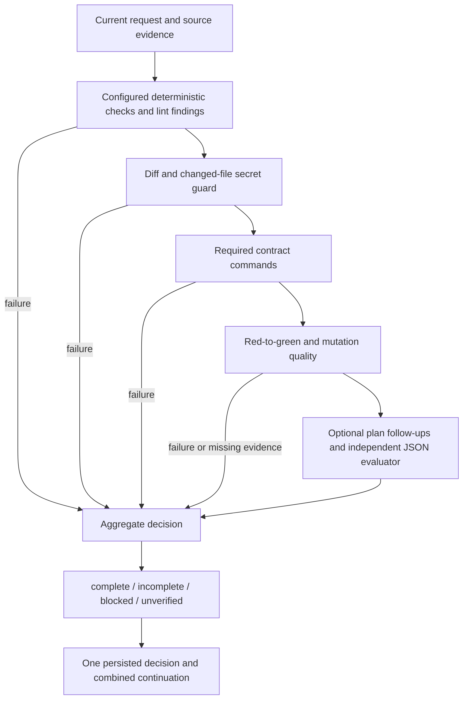

# Phase 2: evidence-driven completion and verification

## Audit and design

The live code already has an aggregate `complete | incomplete | blocked |
unverified` decision, source-generation checks, a contract ledger, diff guards,
bounded strategy reviews and evidence-scoped learned methods. Phase 2 extends
these mechanisms rather than adding competing completion verdicts. An unavailable
required reviewer already ends unverified; the old evaluator fail-open comment
does not describe that behavior.

The completion entry point orders deterministic/diff checks, contract checks,
test-quality checks and independent review, then persists one aggregate verdict
and continuation. Failed cheap stages prevent model review. Project snapshots
capture opaque shell/codegen changes as well as named edit tools. Pre-existing
dirty files are the baseline, not changes attributed to the agent.

Evaluator replies use strict JSON findings with severity, path, line, summary and
evidence. One formatting repair is allowed on an already-configured evaluator;
an unusable second response is logged, counted and ends unverified. It does not
certify completion. Legacy text parsing remains for the separate plan reviewer.

Red-to-green records pair the same completed check across a source change;
opt-in enforcement requires that pair and a current passing regression command.
Lint checks compare error diagnostics before and after each editing call and
keep new findings blocking until resolved. A configured fast linter is optional;
all subprocesses use the existing permission/hook-aware tool dispatch. Repeated
findings feed the existing strategy monitor rather than a second retry loop.

Mutation is opt-in, bounded by time/count and Go-only initially through a
language interface. Tests execute in a temporary project copy; no mutation is
ever written to the user's source. Baseline failures, compile-invalid mutants,
cancellation and timeouts are distinguished from killed/surviving mutants.
Unsupported languages are reported as unverified. Fuzz/property suggestions
are advisory and based on changed parser/codec/numeric code.

Rules retain their originating session, turn/generation and error signature or
verification operation. Old evidence-free rules are not trusted as established
guidance. Age, unsuccessful reuse and inactivity reduce standing and eventually
remove obsolete rules; usage/outcomes are counted. This remains local and adds
no model calls.

## Preflight and Phase 1 follow-up

The 40-task starting suite has 38 single-source solutions, two multisource
solutions (`fix-cart-totals`, `fix-lease-renewal`), one explicitly ambiguous
request (`fix-header-case`) and one explicit scope trap
(`fix-newline-normalization`). These categories overlap. Languages: 20 Go,
10 Python, 10 TypeScript. Single-source does not imply easy: worker-pool and
patch/semver implementations are more substantial. Two additional multisource,
contract-discovery Python/TypeScript tasks are proposed for this phase.

Trace writes mask registered vault values and never accept prompt/result/error
payloads. Per-session rotation is approximately 4 MiB current plus 4 MiB previous.
Phase 1 lacked cross-session cleanup; Phase 2 adds bounded age/quota cleanup
of inactive trace generations. Storage errors remain best effort and counted.
The nine Phase 1 hidden-test renames are explicitly linked in its changed-file
manifest; no staging or commit is required to describe a rename accurately.

## Defaults, cost and rollback

Risky subprocess checks, red enforcement and mutation remain opt-in. Existing
gate decisions and verdict vocabulary are preserved. New options have JSON schema
and atlasrc equivalents, including ablation of lint-fix and mutation. Disabling
the options stops additional checks without modifying user source or deleting
recorded evidence. No paid-provider benchmark is authorized. The authorization
template is protected and will not be changed.

## Configuration and user behavior

All options below are under `options.harness`; atlasrc uses the corresponding
`option harness-<hyphenated-name> VALUE` form. Repeat
`option harness-completion-command 'go test -p 1 ./...'` to add commands.

| Option | Default | Meaning |
|---|---|---|
| `lint_fix` | false | Compare before/after errors and require new errors fixed. |
| `lint_command` | empty | Optional project-wide fast lint command. |
| `lint_timeout_seconds` | 10 | Budget per diagnostic/lint observation. |
| `completion_commands` | empty | Explicit build/test/type/secret-scan checks before review. |
| `red_green` | false | Enforce observed red/edit/green plus configured regression checks. |
| `mutation` | false | Run changed-line Go mutants in a disposable project copy. |
| `mutation_command` | `go test -p 1 -count=1 ./...` | Baseline and mutant test command. |
| `mutation_max` | 4 | Maximum generated mutants (at most 32). |
| `mutation_timeout_seconds` | 60 | Total budget, including copying and baseline (at most 600). |
| `fuzz_hints` | true | Advisory parser/codec/numeric property/fuzz hint, once per request. |
| `no_progress_steps` | 8 | Semantic stagnation threshold after source work begins. |
| `stall_oracle` | false | Allow an already-configured escalator to advise on the second strategy signal. |
| `evaluator_repair` | false | Allow one extra configured-evaluator call to repair invalid JSON. |

Zero numeric budgets select the documented default; invalid negative/excessive
budgets fail validation. Mutation, lint and oracle are opt-in because they can
execute commands, consume time or spend model tokens. The repair option is
also opt-in to comply with the brief's default-off rule for additional model
calls: without it, malformed JSON immediately ends unverified; with it, the
second malformed response ends unverified. Transport failures never certify
completion. Legacy text verdict parsing remains only for plan-review compatibility.

The automatic command checks run through the existing bash tool, hooks,
permissions, ownership and execution budgets. No commands are guessed for an
unknown project. Build, affected test, lint/type and secret-scan commands can be
declared explicitly; the existing diff/secret guard still examines captured
changes before any paid completion review. Ordinary tool error payloads remain
in session output; metadata traces do not copy them.

Red evidence is persisted in session-scoped work-plan state, not inferred from
the model's prose. Checks that did not finish, scratch runs, different command
identities, and a green run before the edit do not supply a pair. With enforcement
on, configure package/integration regression commands in `completion_commands`.
The runtime does not pretend a narrow reproduction is a full regression suite.

Lint metadata distinguishes a clean LSP observation from no running LSP. Missing
observations cannot certify an enabled lint gate. Old errors are informational;
only the delta, including extra occurrences of the same error, is required.
Repeated lint findings and nonzero test exits feed the same strategy monitor as
other failures. New passing commands/files/requirements reset semantic stagnation;
ordinary reads do not. Polling is exempt. The second review can consult only an
explicitly enabled/configured oracle; persistent failure ends with a blocker.

Mutation copies at most 10,000 regular files / 64 MiB, rejecting symlinks and
skipping `.git`, `.atlas`, dependencies and Python environments. Source tokens
are mutated only on changed Go lines. Invalid builds are not killed mutants;
timeouts, cancellation, unsupported source languages and unavailable checks are
unverified. A surviving mutant asks for stronger assertions. The original source
is never the mutation target, including when the runner panics. Configured test
commands remain ordinary trusted project commands, not a sandbox for hostile
scripts that deliberately write to absolute paths outside their working copy.

The original nine hidden test paths now carry `operation: rename` and explicit
`renamed_from` / `renamed_to` relationships in the Phase 1 manifest. Two additional
cross-module tasks make the final suite 42 (20 Go, 11 Python, 11 TypeScript), with
four multisource reference solutions, three explicit ambiguous requests and
three explicit scope traps. Those categories overlap.

`bench/verification-ablation.example.json` enables lint-fix/mutation and disables
each separately over Go tasks, using the Phase 1 pass@1/pass@k, usage, time and
fail-open reporting. No live model run was performed or authorized.

Trace cleanup runs best effort at most hourly when a recorder begins a turn:
inactive owned trace groups expire after 30 days; oldest inactive groups are
removed above 512 MiB. The quota is soft because traces written within 24 hours
are protected. Per-session rotation remains approximately 8 MiB. Pruned counters
are removed too, so a pruned session begins numbering again. Unrelated files and
symlinks are not selected. Cleanup/write failures are logged and counted without
failing the turn. There is no background cleaner while Atlas is idle.

Learned hints without origin evidence are suppressed/pruned, not promoted.
Error fixes record source session, turn/sequence, signature and time. Method
candidates retain runtime operation evidence and generation; distinct task offers
are counted once. Unused candidates expire after 30 days; all candidates after
90 days; repeated ineffective reuse also expires a candidate. Exported skill
files are never automatically removed. Strategy hints derive from recent
origin-linked passing contract events; expiry refreshes even without new events.

## Completion flow

## Validation and follow-up (2026-10-28)

The deterministic stage now applies the complete credential scanner to every
existing changed file, including opaque shell edits. Continuations contain only
finding counts and remediation, never credential values. Red-to-green evidence
records the work-plan feature IDs proved by its command; when a contract has
features, an unrelated red/green pair cannot satisfy enforcement. Learned-method
outcome submission is implemented through the advertised workflow action and
records success/failure metrics alongside method offers and error-memory reuse.

A production-path mutation regression verifies that baseline and mutant checks
use the same disposable directory through guarded tool dispatch and leave the
original source unchanged. Additional tests cover requirement binding, secret
non-disclosure and persisted method outcomes. Phase 2 source files were formatted
with `gofumpt`; `git diff --check` is clean.

Recorded local results with Go 1.27.3, `CGO_ENABLED=0` and
`GOEXPERIMENT=greenteagc`:

- `go build -p 1 ./...`: passed.
- `go vet -p 1` on agent, config, command, verification, work-plan, engineering,
  error-memory and harness-metric packages: passed.
- The same test package set: all passed except the pre-existing environment-
  sensitive `TestNpmCommandWindowsRunsNodeWithoutShellQuoting` in `internal/cmd`.
  The local PATH resolves `node.cmd`, while that test expects `node.exe`; no
  Phase 2 code is involved. Agent, verification, work-plan, engineering,
  error-memory and harness-metric tests passed.
- Focused secret-scan, red/requirement, mutation-integration and learned-outcome
  tests passed before the broader run.

The evaluator now advertises a typed `submit_review` tool schema and extracts
its validated tool-call verdict. Strict local JSON validation and
unverified-on-invalid behavior remain in force. Text replies are a compatibility
fallback, with tool-call versus fallback transport recorded in trace metadata.
A scripted-provider test proves schema advertisement and tool-verdict extraction;
no live provider, paid benchmark, commit, push or pull request was used.
