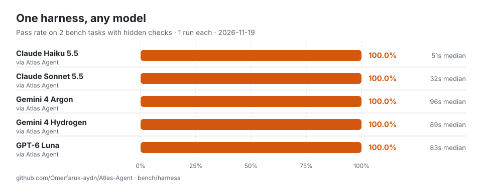
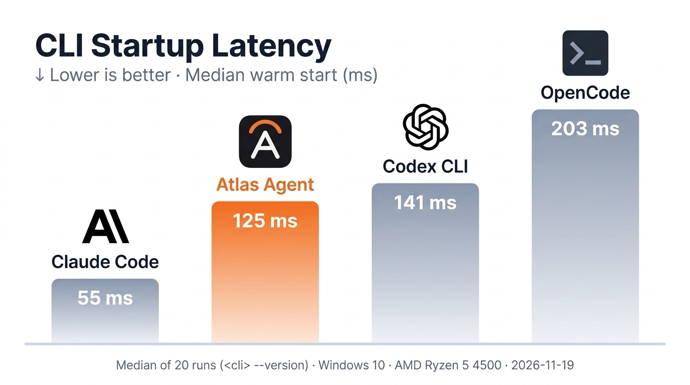
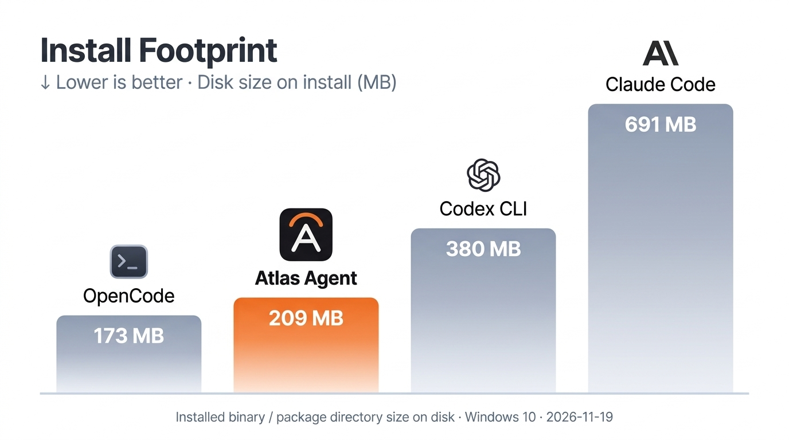
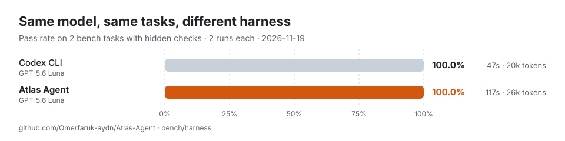
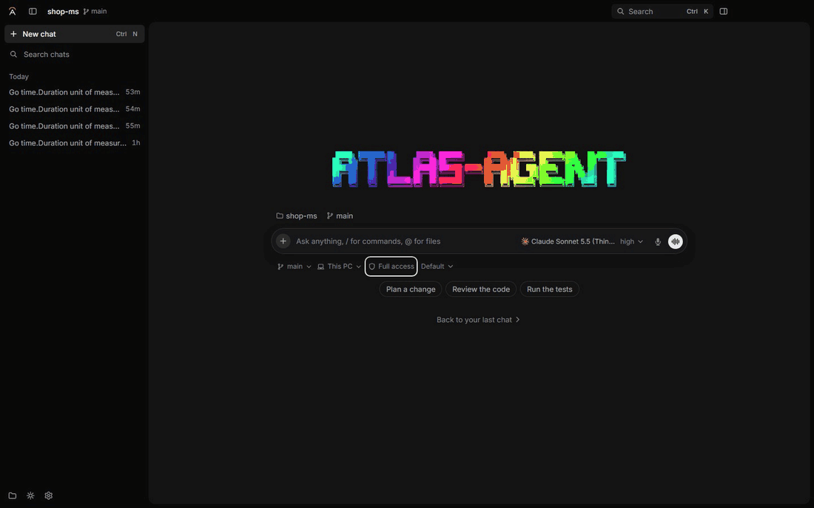

# Benchmarks

How Atlas Agent was measured, and how to reproduce the numbers.

[Back to the README](../../README.md) · [All guides](README.md)

## One harness, _any model_

The same Atlas Agent, the same tasks, five models. Each attempt starts from a fresh copy of the repository,
gets only the task prompt, and is scored by hidden checks the agent never sees.

  <picture>
    <source media="(prefers-color-scheme: dark)" srcset="../assets/harness-bench-dark.svg">
    
  </picture>

> [!NOTE]
> This is a small run: **2 tasks, 1 attempt each**, on the current development build, so every model passing
> both tasks says the harness works, not that the models are equal. An earlier run on the published 0.20.4
> build had Claude Haiku 5.5 hit the 5-minute limit once on one task; it did not repeat here. Treat it as a
> smoke test, not a ranking. The 42-task suite and the runner are in [`bench/harness`](../../bench/harness); larger
> runs will replace this chart.

### Startup

`<tool> --version` from process spawn to exit, median of 20 warm runs on the same machine, no login needed.

| Tool | Start | Install size |
| --- | ---: | ---: |
| Claude Code 2.1.285 | 55 ms | 691 MB |
| **Atlas Agent (this build)** | **125 ms** | 209 MB |
| Codex CLI 0.154.0 | 141 ms | 380 MB |
| OpenCode 2.0.32 | 203 ms | 173 MB |
| Atlas Agent 0.20.4 (published) | 711 ms | 196 MB |

The published 0.20.4 was the slowest. Two start-up costs were found with `GODEBUG=inittrace=1` and removed: the
`login` command decoded the whole model catalog on every start, and two dependencies built large tables in `init`.
Reproduce with `node bench/harness/startup.mjs`.

### Same model, different harness

Each pairing runs both harnesses on the same model, the same two tasks (`add-cache-ttl`, `fix-capped-backoff`)
and the same machine, every attempt from a fresh copy of the repository and scored by hidden checks.

| Model | Harness | Passed | Mean time per task |
| --- | --- | ---: | ---: |
| Claude Sonnet 5.5 | Claude Code 2.1.285 | 6 / 6 | 24 s |
| Claude Sonnet 5.5 | **Atlas Agent** | **6 / 6** | **34 s** |
| GPT-5.6 Luna | Codex CLI 0.154.0 | 4 / 4 | 48 s |
| GPT-5.6 Luna | **Atlas Agent** | **4 / 4** | **95 s** |

Every attempt passed, so on these tasks the harnesses are equal on outcome and Atlas Agent is slower. Two
things explain most of the gap. Atlas runs an independent reviewer before it reports a change as done, which
costs one to three extra model calls. And on GPT-5.6 Luna the comparison is not like for like: Codex reads
`model_reasoning_effort = "low"` from its config, while Atlas uses the model's default, `medium`. Token counts
are left out on purpose: each tool counts cached input differently, so the columns would not compare.

The chart below is the earlier GPT-5.6 Luna run.

  <picture>
    <source media="(prefers-color-scheme: dark)" srcset="../assets/harness-compare-dark.svg">
    
  </picture>

> [!NOTE]
> Two tasks is a smoke test, not a ranking. The harness definitions are in
> [`harnesses.json`](../../bench/harness/harnesses.json); `node bench/harness/run.mjs --harnesses claude-code,atlas-sonnet`
> reproduces a pairing on any machine signed in to both.

Switch models in the middle of a thread and it carries on with the full context:

