# Feature tour

Every feature, each with a short clip recorded on a real model.

[Back to the README](../../README.md) · [All guides](README.md)

## Features

### 01 · Orchestrator mode

Hand it a large task and the lead agent plans the work, starts workers in parallel, coordinates them on a
team board, waits for every result and has an independent verifier check the combined outcome before it
reports. The lead never edits files itself, so its context stays about the plan. [Orchestrator mode](../orchestrator-mode.md)

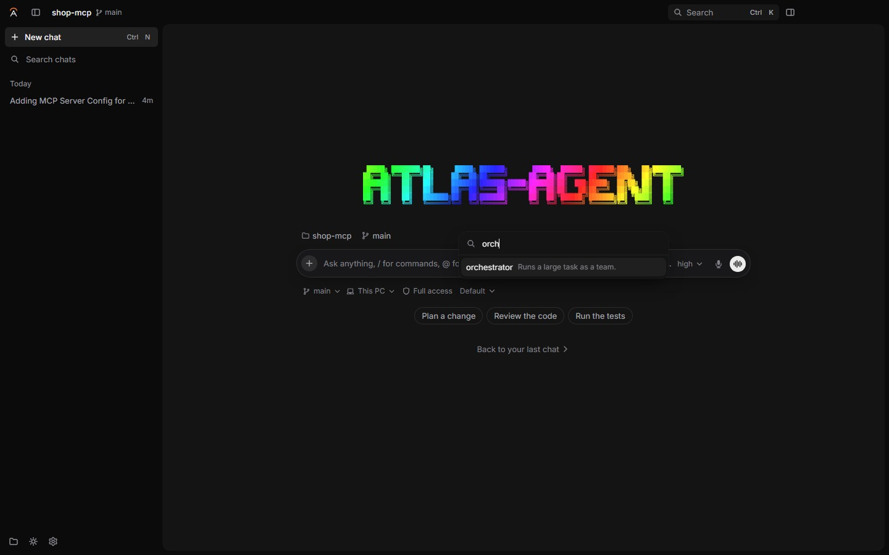

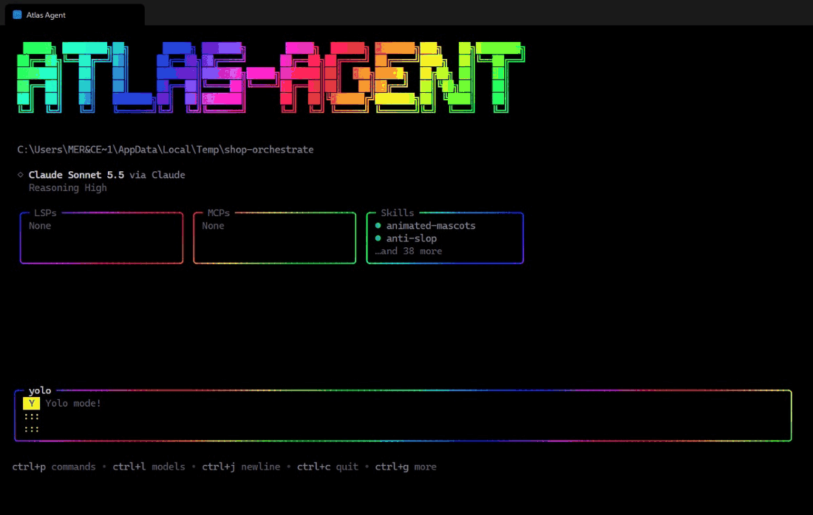

### 02 · Subagents that keep your context small

A subagent runs in a session of its own. Everything it reads and greps stays there; only the answer comes
back. Reading twenty files to answer one question costs you a paragraph, not twenty files.
[Token economics](cost.md#token-economics-why-delegation-is-cheaper)

### 03 · Debate: models that argue before they agree

`debate` puts one question to several models over multiple rounds. Each sees what the others said and answers
it; a judge can close it out. Disagreement that survives is reported as disagreement instead of being averaged
into a consensus nobody reached. [Delegation](delegation.md#delegation-agent-orchestrate-delegate-debate)

### 04 · Goals that keep going

Set a goal with `/goal` and walk away. Atlas works toward it step by step and a separate judge model decides
whether it is truly finished, so "done" is checked and not claimed. [Autonomous goals](delegation.md#autonomous-goals)

### 05 · Configure it by talking to it

"Use the cheap model for summaries." "Turn the browser tool on." "Make me a subagent that only reviews UI."
`atlas_config` makes the change and tells you what it did. No settings dialog to hunt through.
[Talk to it to configure it](delegation.md#talk-to-it-to-configure-it)

### 06 · Review before you keep

Every turn that changes files ends with a card: open the diff, undo what you don't like, keep what you do.
Undo refuses to run when the file has changed since, so your own edits are never overwritten.

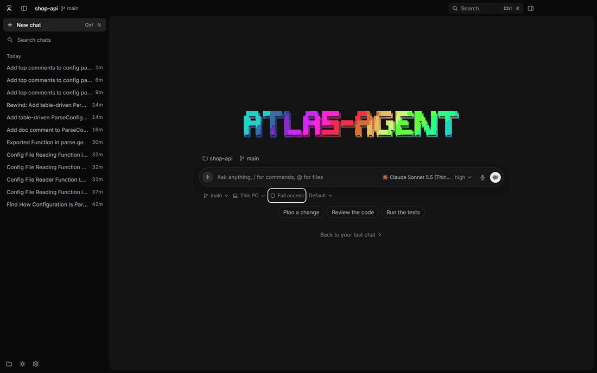

### 07 · Go back to any message

Rewind a thread to an earlier message and the files go back with it, so a bad turn costs one click.

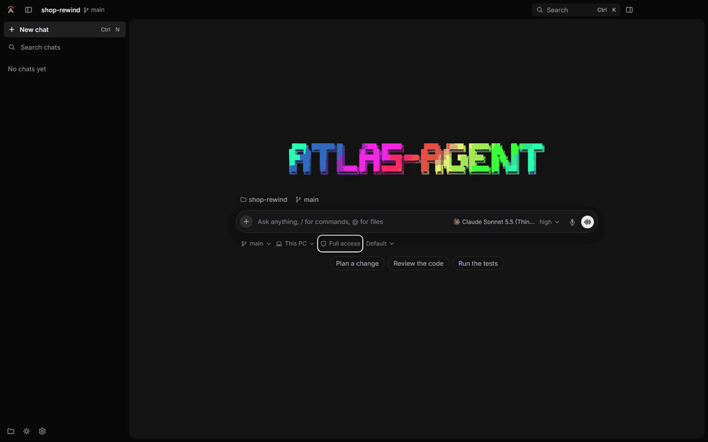

### 08 · Safe by default

Every command with a side effect asks first, unless you say otherwise. A policy layer refuses to run files
that came from the network until you have cleared them. [Permissions and safety](safety.md#permissions-and-safety)

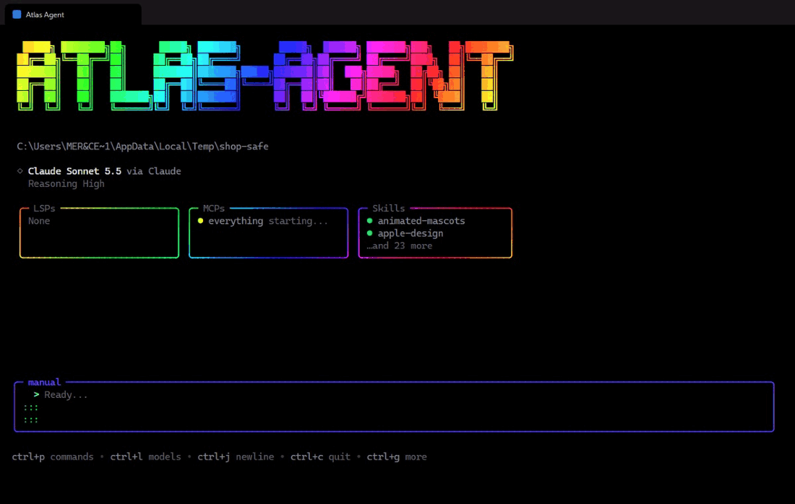

### 09 · Hooks can veto

A `PreToolUse` hook is a shell script. Here one protects `migrations/`: the edit is blocked, the agent explains
why and offers the compliant alternative. [Hooks](../hooks/README.md)

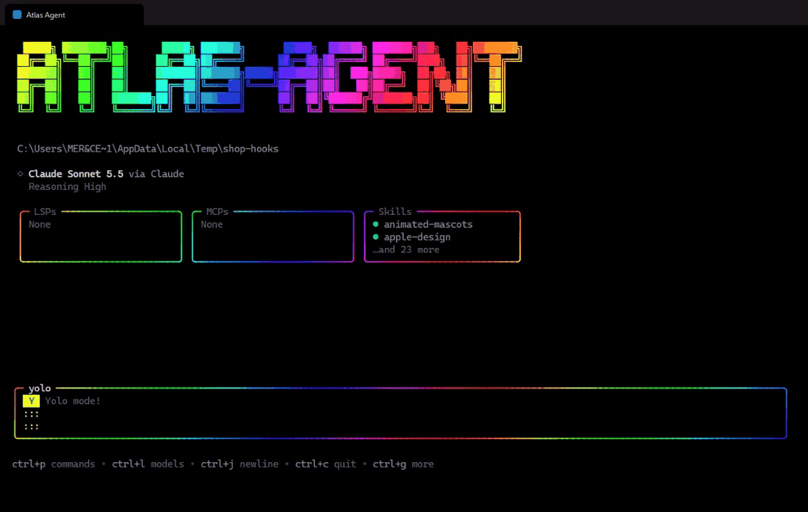

### 10 · Drives a real browser

The browser tool drives a visible Chrome window of its own. Here the agent serves a local site, clicks every
link, finds the one that returns a 404 and fixes it. The clip is that Chrome window, cropped to the page.
[Browser and desktop automation](../INTERACTION_AUTOMATION.md)

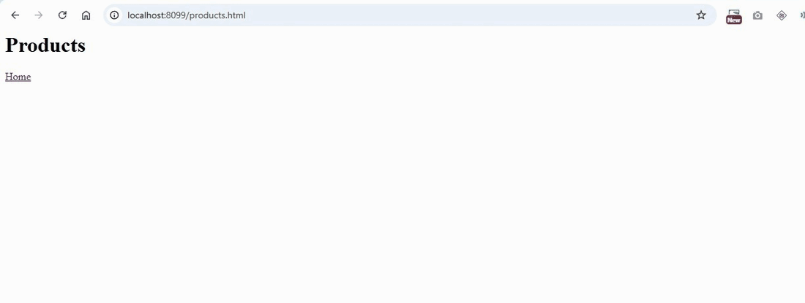

### 11 · Refactors through the language server

Renames go through the language server, so every reference moves and nothing else does. The agent previews the
rename, applies it and proves the build still passes. [Tools](tools.md#code-intelligence-lsp)

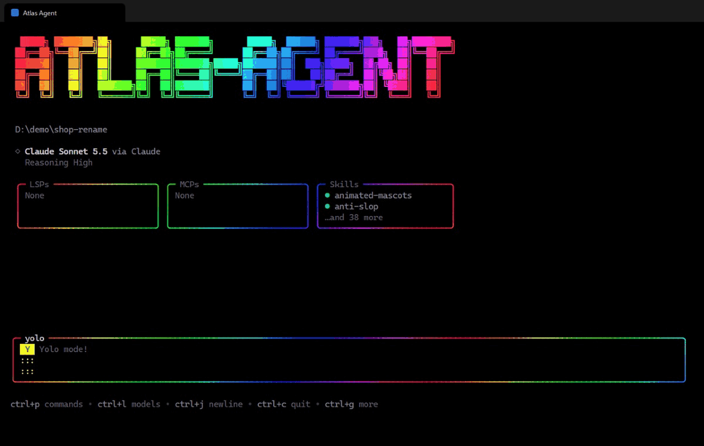

### 12 · Skills

Drop a `SKILL.md` into `.atlas/skills/` and the agent finds it by its description and follows it step by step.
[Extensibility](extending.md#extensibility-skills-mcp-hooks)

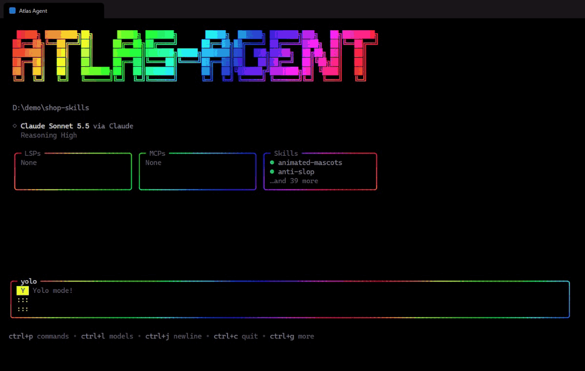

### 13 · MCP in plain words

Ask for an MCP server in plain words; the agent writes the config entry, the server's tools show up, and the
next message already uses one.

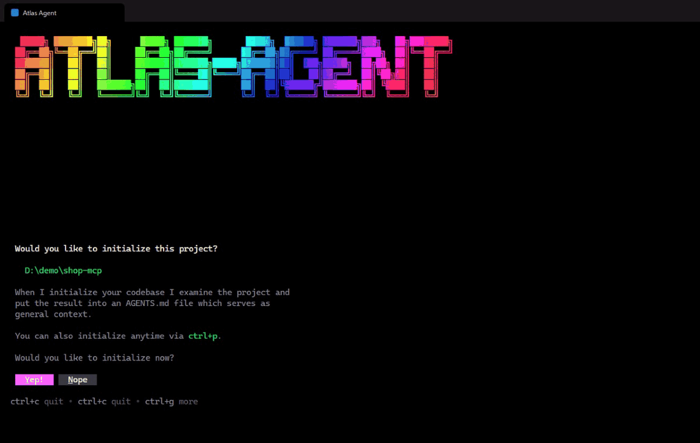

### 14 · Worktrees for parallel work

Two branches, two checkouts, one repository, so independent tasks never trample each other.
[Worktrees and teams](sessions.md#sessions-worktrees-and-teams)

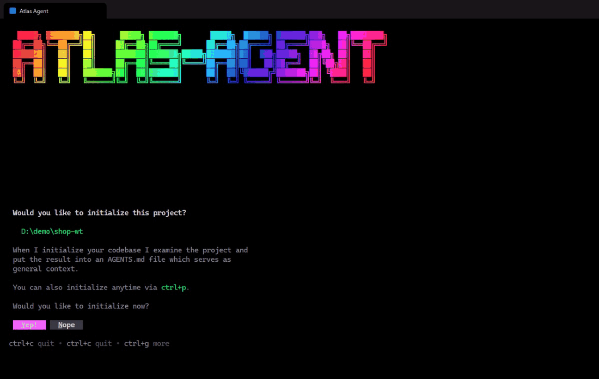

### 15 · Pull request review

Point it at a PR and get priorities and a verdict. This one reviews real dependency-bump PRs of this repository.

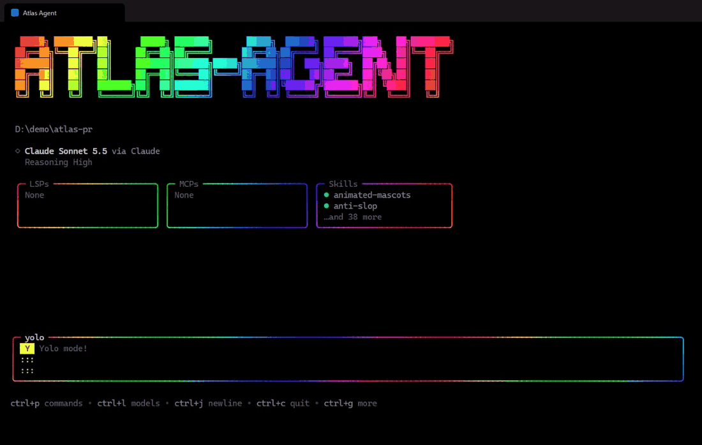

### 16 · Headless, for CI and scripts

`atlas-agent run --output-format json` prints one JSON object with the answer, token counts and cost.

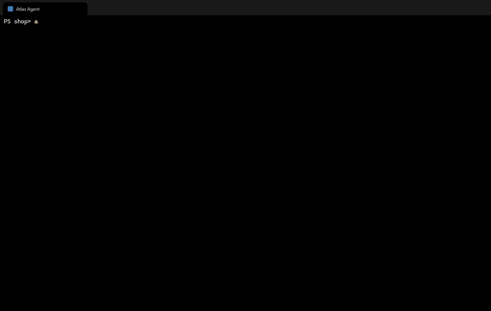

### 17 · Hands on the Windows desktop

Switch on the computer tool and the agent works real Windows apps. Here it opens Notepad, types a release note and
saves it to a folder it creates. The recording shows only the Notepad window.
[Browser and desktop automation](../INTERACTION_AUTOMATION.md)

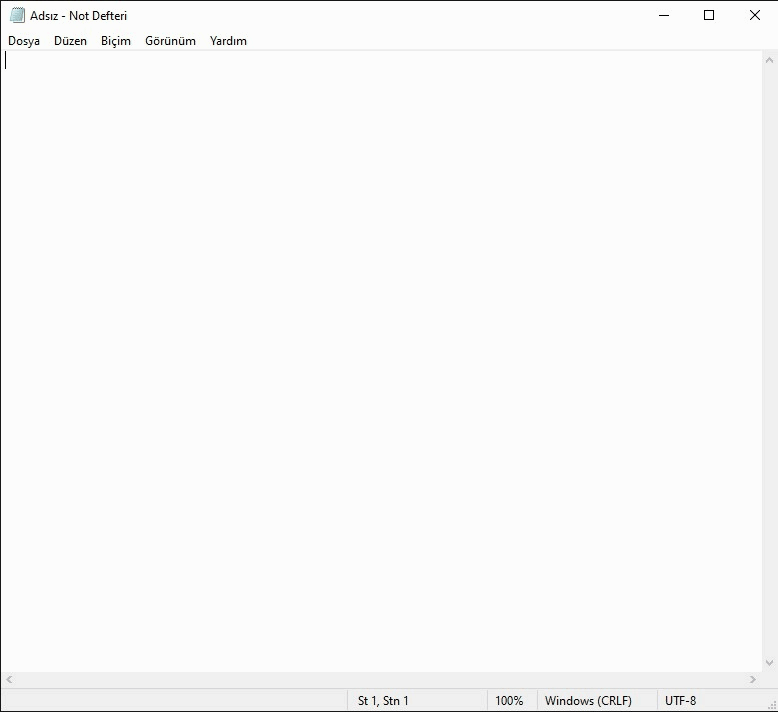

### 18 · Talk to it

Press the mic in the app, say the task, and an offline recognizer turns it into text in the composer before you
send it. Nothing leaves the machine for the transcription. This take uses a synthetic voice played into the
microphone input, and the transcript is exactly what the recognizer returned.

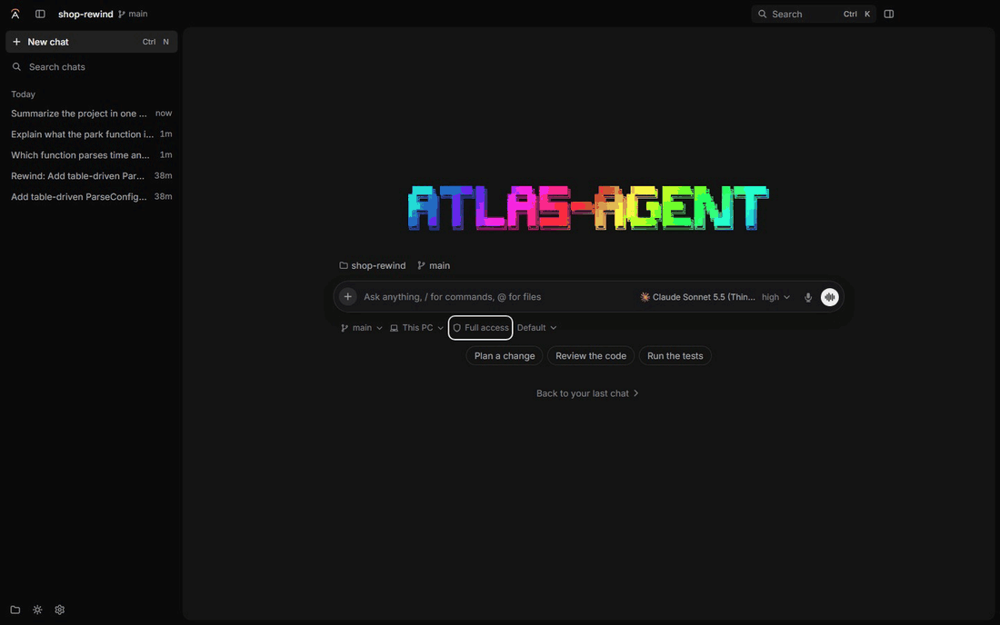

